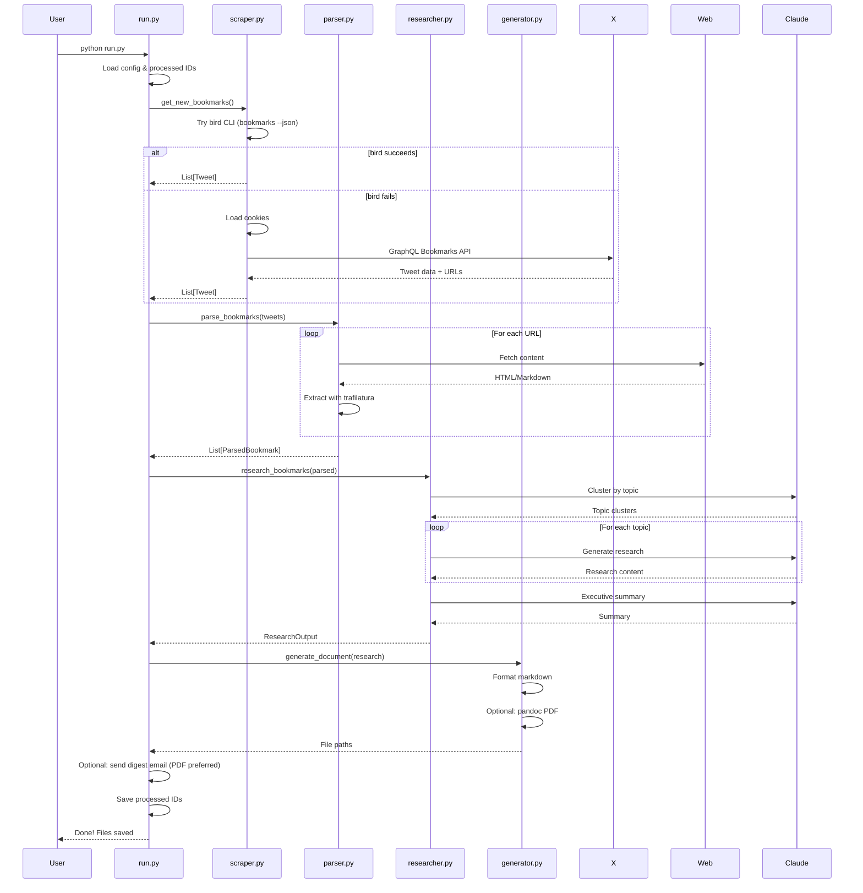

# Bookmark Digest

> Personal AI Research Pipeline - Transform your X bookmarks into comprehensive learning documents

Automated system that reads your X bookmarks weekly, extracts linked content, uses AI to research topics in depth, and generates a formatted learning document with optional podcast conversion.

## Overview

**Pipeline:** X Bookmarks → Content Extraction → AI Research → Markdown/PDF → (Optional) Email Delivery → (Optional) Podcast

Instead of letting bookmarks pile up unread, Bookmark Digest processes them into actionable knowledge. The AI clusters related content, determines appropriate depth for each topic, and synthesizes research that goes beyond simple summarization.

## Architecture

### High-Level Pipeline

```
┌─────────────────┐     ┌──────────────────┐     ┌─────────────────┐     ┌──────────────────┐
│   X Bookmarks   │────▶│     Content      │────▶│   AI Research   │────▶│     Output       │
│   (via cookies) │     │     Parser       │     │   & Synthesis   │     │   md/pdf/mp3     │
└─────────────────┘     └──────────────────┘     └─────────────────┘     └──────────────────┘
        │                       │                        │                       │
        ▼                       ▼                        ▼                       ▼
   Bird CLI + Cookie      trafilatura             Claude/GPT              pandoc/TTS
   GraphQL Fallback       httpx fetch             Topic Clustering        NotebookLM
```

### Component Flow

```mermaid
flowchart TB
    subgraph Input
        X[X.com Bookmarks]
        C[Browser Cookies]
    end

    subgraph Scraper["scraper.py"]
        S1[Bird CLI (Primary)]
        S2[Internal GraphQL (Fallback)]
        S3[Tweet Parser]
    end

    subgraph Parser["parser.py"]
        P1[URL Extraction]
        P2{Content Type?}
        P3[Article Extractor]
        P4[GitHub README]
        P5[arXiv Abstract]
        P6[YouTube Info]
    end

    subgraph Researcher["researcher.py"]
        R1[Topic Clustering]
        R2{Complexity?}
        R3[Simple Summary]
        R4[Medium Analysis]
        R5[Deep Dive]
        R6[Executive Summary]
    end

    subgraph Generator["generator.py + audio.py + emailer.py"]
        G1[Markdown Output]
        G2[PDF via pandoc]
        G5[Gmail SMTP Email]
        G3[TTS Audio]
        G4[NotebookLM Ready]
    end

    X --> S1
    C --> S1
    S1 --> S3
    S1 -.failure.-> S2 --> S3

    S3 --> P1
    P1 --> P2
    P2 -->|Article| P3
    P2 -->|GitHub| P4
    P2 -->|arXiv| P5
    P2 -->|YouTube| P6

    P3 & P4 & P5 & P6 --> R1
    R1 --> R2
    R2 -->|Simple| R3
    R2 -->|Medium| R4
    R2 -->|Complex| R5
    R3 & R4 & R5 --> R6

    R6 --> G1
    G1 --> G2
    G1 --> G5
    G1 --> G3
    G1 --> G4
```

### Data Flow



### Module Architecture

```
bookmark-digest/
│
├── run.py                      # CLI entry point & orchestrator
│   └── Chains: scraper → parser → researcher → generator
│
├── src/
│   ├── __init__.py
│   │
│   ├── scraper.py              # X Bookmark Extraction
│   │   ├── BookmarkScraper     # Main scraper class
│   │   │   ├── fetch_bookmarks()    # Async GraphQL fetching
│   │   │   ├── _parse_tweet()       # Tweet data extraction
│   │   │   └── save_raw_data()      # Debug output
│   │   └── get_new_bookmarks() # Convenience function with dedup
│   │
│   ├── parser.py               # Content Extraction
│   │   ├── ContentParser       # URL content fetcher
│   │   │   ├── _extract_github()    # GitHub README extraction
│   │   │   ├── _extract_arxiv()     # arXiv abstract extraction
│   │   │   ├── _extract_youtube()   # YouTube metadata
│   │   │   └── _extract_article()   # Generic via trafilatura
│   │   ├── ParsedBookmark      # Tweet + extracted content
│   │   └── ExtractedContent    # Single URL's content
│   │
│   ├── researcher.py           # AI Research & Synthesis
│   │   ├── AIResearcher        # Research orchestrator
│   │   │   ├── cluster_bookmarks()  # AI topic grouping
│   │   │   ├── research_topic()     # Per-topic deep dive
│   │   │   └── generate_summary()   # Executive summary
│   │   ├── TopicCluster        # Group of related bookmarks
│   │   └── ResearchOutput      # Complete research result
│   │
│   ├── generator.py            # Document Generation
│   │   ├── DocumentGenerator   # Markdown/PDF creator
│   │   │   ├── generate_markdown()  # Format research
│   │   │   ├── save_markdown()      # Write .md file
│   │   │   └── generate_pdf()       # pandoc conversion
│   │   └── generate_document() # Convenience function
│   │
│   └── audio.py                # Audio Generation
│       ├── AudioGenerator      # TTS orchestrator
│       │   ├── _prepare_text_for_speech()  # Clean markdown
│       │   ├── _generate_openai_audio()    # OpenAI TTS
│       │   └── _generate_elevenlabs_audio()# ElevenLabs TTS
│       └── print_notebooklm_instructions() # Manual workflow
│
├── config/
│   ├── config.yaml             # All settings
│   ├── cookies.json            # X auth (gitignored)
│   └── com.bookmark-digest.plist  # macOS scheduling
│
└── data/
    ├── processed.json          # Deduplication tracking
    └── raw/                    # Debug: raw API responses
```

## Features

### Intelligent Processing
- **Deduplication**: Tracks processed bookmark IDs to avoid reprocessing
- **Adaptive Depth**: AI determines complexity level per topic:
  - *Simple*: 1-2 paragraph summary for familiar concepts
  - *Medium*: 3-5 paragraphs with context and implications
  - *Complex*: Full deep-dive with examples (500-1000 words)

### Content Extraction
- **Articles**: Full text extraction via trafilatura
- **GitHub**: README.md fetching from repositories
- **arXiv**: Paper abstracts and metadata
- **YouTube**: Video titles and descriptions
- **Threads**: Full tweet thread extraction

### Output Formats
- **Markdown**: Clean, readable format
- **PDF**: Via pandoc (optional)
- **Audio**: OpenAI TTS or ElevenLabs
- **NotebookLM**: Compatible for podcast generation

## Quick Start

```bash
# Clone the repo
git clone https://github.com/ruari8/bookmark-digest.git
cd bookmark-digest

# Install dependencies
pip install -r requirements.txt

# Install bird CLI (recommended primary scraper)
# npm:
npm install -g @steipete/bird
# or Homebrew:
# brew install steipete/tap/bird

# Set up your X cookies (see below)
cp config/cookies.example.json config/cookies.json

# AI setup (choose one)
#
# Recommended (no API keys, uses Claude subscription via Claude Code CLI):
# 1) Install/login to Claude Code
# 2) Ensure this works (unattended, default tool set enabled):
#    claude -p --model opus --permission-mode bypassPermissions --allow-dangerously-skip-permissions --dangerously-skip-permissions "Reply with exactly: OK"
#
# API options (separately billed):
# export ANTHROPIC_API_KEY="your-key-here"
# or
# export OPENAI_API_KEY="your-key-here"

# Optional for email delivery
export GMAIL_SMTP_USERNAME="your-digest-bot@gmail.com"
export GMAIL_SMTP_APP_PASSWORD="your-16-char-app-password"

# Run
python run.py
```

## Getting X Cookies

The scraper authenticates using your browser session cookies. Here's how to get them:

1. Open [x.com](https://x.com) in your browser and log in
2. Open DevTools (`F12` or `Cmd+Option+I`)
3. Go to the **Network** tab
4. Refresh the page
5. Click any request to `x.com`
6. In **Request Headers**, find `Cookie`
7. Copy the values for `auth_token` and `ct0`
8. Add them to `config/cookies.json`:

```json
{
  "auth_token": "your_auth_token_value",
  "ct0": "your_ct0_value"
}
```

> **Note:** Cookies expire every 2-4 weeks. Refresh them when you see a 401 error.
>
> The app now uses `bird` as primary and falls back to built-in GraphQL scraping.
> If `bird` is missing or fails, cookie-based fallback still works.

## Usage

```bash
# Process new bookmarks (default behavior)
python run.py

# Process all bookmarks, ignoring history
python run.py --force

# Only process bookmarks since a specific date
python run.py --since 2026-01-19

# Limit number of bookmarks processed
python run.py --max-bookmarks 20

# Generate PDF output
python run.py --output-format pdf

# Generate both markdown and PDF
python run.py --output-format both

# Generate audio using OpenAI TTS
python run.py --tts

# Show NotebookLM instructions for manual podcast generation
python run.py --notebooklm

# Dry run - fetch bookmarks but don't generate documents
python run.py --dry-run

# Send digest email using config recipients
python run.py --email

# Override recipients for a manual test run
python run.py --email --email-to "me@example.com"
```

## Configuration

Edit `config/config.yaml` to customize behavior:

```yaml
# Output settings
output:
  directory: "../"              # Where to save files (relative to project)
  format: "markdown"            # markdown, pdf, or both
  filename_template: "weekly-digest-{date}.md"

# AI settings
ai:
  provider: "claude_cli"        # claude_cli (Claude subscription), anthropic (API), openai (API)
  model: "opus"                 # Opus 4.6 (Claude Code alias)
  max_tokens: 8192
  claude_cli_tools: "WebSearch,WebFetch"  # recommended: web-only discovery research
  claude_cli_permission_mode: "bypassPermissions"
  claude_cli_dangerously_skip_permissions: false

# Scraper settings
scraper:
  max_bookmarks: 0              # 0 = no limit
  days_limit: 7                 # Only last 7 days

# Audio settings
audio:
  enabled: false
  provider: "openai"            # openai or elevenlabs
  voice: "alloy"                # OpenAI: alloy, echo, fable, onyx, nova, shimmer

# Email settings
email:
  enabled: false
  provider: "gmail_smtp"
  from_address: "your-digest-bot@gmail.com"
  to_addresses:
    - "your-main-email@gmail.com"
  smtp_host: "smtp.gmail.com"
  smtp_port: 587
  smtp_username_env: "GMAIL_SMTP_USERNAME"
  smtp_password_env: "GMAIL_SMTP_APP_PASSWORD"
  attach_preferred: "pdf"      # pdf | markdown
  attach_fallback: "markdown"  # markdown | none
  send_on_empty: false
  subject_prefix: "Bookmark Digest"
```

## Email Delivery (Gmail SMTP)

This repo can email the weekly digest using Gmail SMTP.

### One-time Gmail setup

1. Create/sign in to a dedicated sender Gmail account.
2. Enable 2-Step Verification on that account.
3. Create an App Password (Google Account → Security → App passwords).
4. Set environment variables:

```bash
export GMAIL_SMTP_USERNAME="your-digest-bot@gmail.com"
export GMAIL_SMTP_APP_PASSWORD="your-16-char-app-password"
```

5. Update `config/config.yaml` email `from_address` and `to_addresses`.

### Manual verification (full pipeline)

```bash
python run.py --output-format pdf --email --force --max-bookmarks 5
```

Expected behavior:
- PDF attached when generated.
- Markdown attached if PDF generation fails.
- If no new bookmarks, status email is sent (if `send_on_empty: true`).

## Scheduling

### macOS (launchd)

```bash
# Install the launch agent
cp config/com.bookmark-digest.plist ~/Library/LaunchAgents/

# Set required env vars for launchd (persist for your user session)
# If using claude_cli (default), no AI API key is required.
# If using API providers, set the key(s) here for launchd:
# launchctl setenv ANTHROPIC_API_KEY "sk-ant-..."
# launchctl setenv OPENAI_API_KEY "sk-..."
launchctl setenv GMAIL_SMTP_USERNAME "your-digest-bot@gmail.com"
launchctl setenv GMAIL_SMTP_APP_PASSWORD "your-16-char-app-password"

# Load (start scheduling)
launchctl load ~/Library/LaunchAgents/com.bookmark-digest.plist

# Unload (stop scheduling)
launchctl unload ~/Library/LaunchAgents/com.bookmark-digest.plist

# Test run manually
launchctl start com.bookmark-digest

# Check logs
tail -f data/launchd.log
```

Default schedule: **Sundays at 8:00 AM**
The provided plist runs `run.py --output-format pdf --email`.

### Linux (cron)

```bash
# Edit crontab
crontab -e

# Add line for Sunday 8am
0 8 * * 0 cd /path/to/bookmark-digest && /usr/bin/python3 run.py >> data/cron.log 2>&1
```

## Output Example

Generated digests are saved to the parent directory:

```
learn/
├── weekly-digest-2026-01-26.md   # This week's digest
├── weekly-digest-2026-01-19.md   # Last week's
├── ai-coding-agents.md           # Your other research docs
└── bookmark-digest/              # This tool
```

### Sample Output Structure

```markdown
# Weekly Bookmark Digest
*Generated on January 26, 2026*

## Executive Summary
This week's bookmarks covered three main themes: advances in AI agents,
new developments in Rust web frameworks, and interesting takes on
startup fundraising strategies...

## AI Agents and Tool Use
*Developments in autonomous AI systems* | **Deep Dive**

Recent developments in AI agents have shown remarkable progress in...
[500-1000 words of synthesized research]

## Rust Web Frameworks
*Comparing Axum, Actix, and new entrants* | **Moderate**

The Rust web framework ecosystem continues to evolve...
[3-5 paragraphs]

## Further Reading
### AI Agents and Tool Use
- [Building Effective Agents](https://example.com/...) (article)
- [anthropics/agent-sdk](https://github.com/...) (github)
```

## Tech Stack

| Component | Technology |
|-----------|------------|
| Language | Python 3.11+ |
| X Scraping | `bird` CLI (primary) + `httpx` cookie GraphQL fallback |
| Article Extraction | `trafilatura` |
| AI Research | Anthropic Claude / OpenAI GPT |
| PDF Generation | `pandoc` |
| TTS | OpenAI TTS API / ElevenLabs |
| Email | Gmail SMTP |
| CLI Framework | `click` |
| Scheduling | `launchd` (macOS) / `cron` |

## Environment Variables

```bash
# AI (pick one)
#
# Default: Claude subscription via Claude Code CLI (no API keys needed).
# For API usage (separately billed), set one of:
# export ANTHROPIC_API_KEY="sk-ant-..."
# export OPENAI_API_KEY="sk-..."

# Optional for audio
export OPENAI_API_KEY="sk-..."          # For OpenAI TTS
export ELEVENLABS_API_KEY="..."         # For ElevenLabs TTS

# Required for Gmail SMTP delivery (if email enabled)
export GMAIL_SMTP_USERNAME="your-digest-bot@gmail.com"
export GMAIL_SMTP_APP_PASSWORD="your-16-char-app-password"
```

## Troubleshooting

| Issue | Solution |
|-------|----------|
| `401 Unauthorized` | X cookies expired. Get fresh ones from browser DevTools. |
| `bird fetch failed` | Install `bird` CLI or fix bird auth; app will fall back automatically. |
| `No bookmarks found` | Check that you have bookmarks on X and cookies are correct. |
| `PDF generation failed` | Install pandoc: `brew install pandoc` |
| `Email attachment error` | PDF/Markdown output file missing; verify output generation path and permissions. |
| `Email delivery failed` | Check Gmail app password, SMTP env vars, and recipient config. |
| `Failed to send status email` | SMTP auth/config issue when run had no bookmarks; verify env vars and Gmail settings. |
| `Audio generation failed` | Check your OpenAI API key is set and has credits. |
| `claude CLI call failed` | Ensure Claude Code is logged in and `ai.model` is valid (e.g. `opus`). |
| `ANTHROPIC_API_KEY not set` | Only relevant if you set `ai.provider: anthropic`. |

## Development

```bash
# Install dev dependencies
pip install -r requirements.txt

# Test scraper
python -m src.scraper

# Test content extraction
python -m src.parser

# Test with mock data
python -m src.researcher
```

## License

MIT

---

*Built for personal learning automation. Transform your bookmark graveyard into actionable knowledge.*
